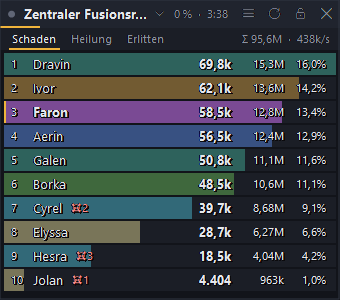
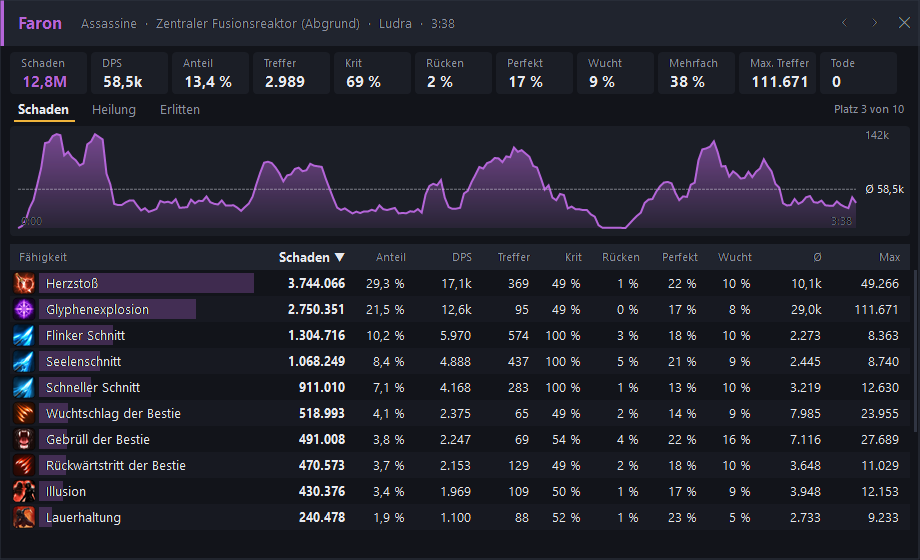

# DPS-Meter für Aion 2

**English:** [README.md](README.md)

Ein Schadensmesser als Overlay, ähnlich wie NotMeter oder A2Tools: Schaden, Heilung und erlittener Schaden
pro Spieler, und per Klick die **Skill-Details** eines Spielers. Der Meter liest nur den Netzwerkverkehr von Aion 2 mit
(Npcap, wie Wireshark) und verändert nichts am Spiel. Ins Internet geht er nur für die Update-Prüfung bei GitHub und um
die Skill-Icons vom offiziellen Spieldaten-Server von NCSOFT zu laden (beides abschaltbar).





*Die Spielernamen in den Bildern sind erfunden.*

> **Achtung:** Laut einem anderen Tool-Autor wertet der NCSOFT-Support Programme, die Spieldaten auslesen, als Verstoß
> gegen die Nutzungsbedingungen. **Benutzung auf eigenes Risiko.**

## Herunterladen

1. [**Npcap**](https://npcap.com/#download) installieren (Standardoptionen; den Haken bei „Restrict Npcap driver's
   access to Administrators only“ NICHT setzen).
2. `DpsMeter.exe` unter [**Releases**](../../releases/latest) herunterladen und starten. Keine Installation, .NET ist
   enthalten. Warnt SmartScreen: *Weitere Informationen → Trotzdem ausführen* (die Datei ist nicht signiert).
3. Aion 2 im Modus **Rahmenloses Fenster** spielen (Vollbild-Exklusiv verdeckt Overlays).

## Benutzung

1. `DpsMeter.exe` starten. Das Meter erscheint oben rechts am Bildschirm, dazu ein Symbol im Infobereich.
2. Ist das Spiel schon offen: einmal das Gebiet wechseln oder teleportieren, dann erkennt der Meter deinen Charakter.
3. Kämpfe werden von allein erkannt. Jeder Boss bekommt einen eigenen Kampf. Ein Kampf endet, wenn alle Gegner tot
   sind oder einige Sekunden lang kein Treffer kommt.

**Im Meter-Fenster**

- **Titel anklicken**: Kampf wählen (aktueller Kampf, alle Kämpfe zusammen, frühere Kämpfe).
- **Reiter** Schaden / Heilung / Erlitten.
- **Zeile anklicken**: Skill-Details dieses Spielers.
- Kopfzeile ziehen = verschieben, Ränder ziehen = Größe ändern, Rechtsklick = Menü.
- Knöpfe oben rechts: Menü, neuer Kampf, fixieren (Klicks gehen ans Spiel), ausblenden.

**Skill-Details**

- Kacheln: Schaden, DPS, Anteil, Treffer, Krit, Rücken, Perfekt, Wucht, Mehrfach, größter Treffer, Tode.
- DPS-Verlauf über den Kampf (5-Sekunden-Mittel, gestrichelt der Durchschnitt).
- Tabelle aller Skills **mit ihrem Icon aus dem Spiel**: Schaden, Anteil, DPS, Treffer, Krit %, Rücken %, Perfekt %,
  Wucht %, Mehrfach %, Ø, Max, Verfehlt. Spaltenkopf anklicken = sortieren. DoT-Ticks stehen als eigene Zeile „(DoT)“.
- ◀ ▶ blättern durch die Spieler des Kampfs.

**Tasten**

| Taste | Wirkung |
|---|---|
| Strg+Alt+D | Meter zeigen / ausblenden |
| Strg+Alt+N | neuer Kampf |
| Strg+Alt+L | fixieren / lösen (fixiert gehen Klicks durch das Meter ans Spiel) |

Im Menü: Deckkraft, Textgröße, Kampfende nach x Sekunden, Skill-Icons, Sprache (Deutsch/English), Zusammenfassung
kopieren, automatische Updates.

**Skill-Icons** lädt der Meter einmal vom Spieldaten-Server von NCSOFT (`assets.playnccdn.com`) und legt sie in
`%APPDATA%\DpsMeter\icons` ab (je etwa 10 KB). Abschalten im Menü unter „Skill-Icons in den Details“.

**Updates** installieren sich von selbst: Der Meter fragt nach dem Start und alle 6 Stunden bei GitHub nach und
installiert eine neue Version nur, wenn du gerade nicht kämpfst und in keinem Dungeon bist. Danach startet er neu.
Abschalten im Menü unter „Automatische Updates“, von Hand über „Nach Updates suchen“.

Einstellungen und Fehlerprotokoll: `%APPDATA%\DpsMeter` (Pfad in die Adresszeile des Explorers einfügen). Bei Problemen
hilft die Datei `fehler.log` aus diesem Ordner.

## Wer wird gezählt

- Du selbst immer, mit deinen Beschwörungen, Fallen und Effekten (Geister, Bitterkalter Wind, Heilige Aura …).
- In Dungeons und Raids alle Spieler der Instanz.
- In der offenen Welt andere Spieler nur auf Gegnern, die du selbst bekämpfst (eine Gruppen-Erkennung gibt es noch
  nicht).

Geprüft an eigenen Mitschnitten vom 05.11. und 08.11.2026: Der gezählte Schaden auf Bosse (Gadioton, Harcon, Berk,
Auldor, Raur, Fusionsreaktor, Ketu, Ludra) stimmt zu 100,0 bis 100,5 % mit den HP überein, die der Boss verloren hat
(der Rest ist Overkill des letzten Treffers).

Heilung ist ungenauer: Gezählt werden bekannte Heilskills und Heilung über Zeit, Schilde und Tränke nicht. Treffer von
Effekten, deren Wirken der Meter nicht gesehen hat (z. B. weil er mitten im Kampf gestartet wurde), stehen unter
„Sonstige“.

## Zum Testen ohne Spiel

```
DpsMeter replay <aufnahme.pcapng> [--speed 4]     Aufnahme im Meter abspielen
DpsMeter bericht <aufnahme.pcapng> [--skills]      alle Kämpfe als Text, mit Boss-HP-Abgleich
DpsMeter vorschau <aufnahme.pcapng> [--anonym]     Meter und Skill-Details als PNG (--anonym: erfundene Namen)
```

Aufnahmen vom [Raid-Ansager](https://github.com/dr89mh/aion2-raid-ansager) (`%APPDATA%\RaidAnsager\mitschnitte`) und
vom [Cube Radar](https://github.com/dr89mh/aion2-cube-radar) funktionieren direkt.

## Bauen

```
git clone --recurse-submodules https://github.com/dr89mh/aion2-dps-meter.git
cd aion2-dps-meter
publish.cmd                 # dist\DpsMeter.exe (eine Datei, .NET enthalten)
```

Braucht das .NET-10-SDK.

## Herkunft

Mitschnitt, TCP-Zusammensetzung und Paketzerlegung kommen aus dem Cube Radar (Git-Submodul). Das Protokollwissen
stammt aus HamMeter (docs/protocol.md) und aion2-dps-meter. Die Spieldaten (Skill-, NPC- und Dungeon-Namen) kommen über
[aion2-dps-meter](https://github.com/cyberbadger6969/aion2-dps-meter) von
[A2Tools-DPS-Meter](https://github.com/taengu/A2Tools-DPS-Meter). Alles steht unter GPL-3.0, Spieldaten © NCSOFT. Die
Skill-Icons liegen nicht im Repo: Das Programm lädt sie vom Spieldaten-Server von NCSOFT, die Icon-Namen folgen
A2Tools-DPS-Meter. Icons © NCSOFT.
