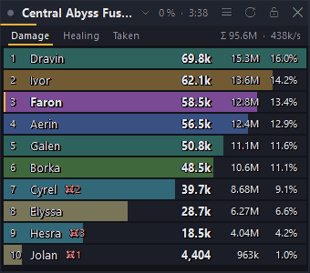
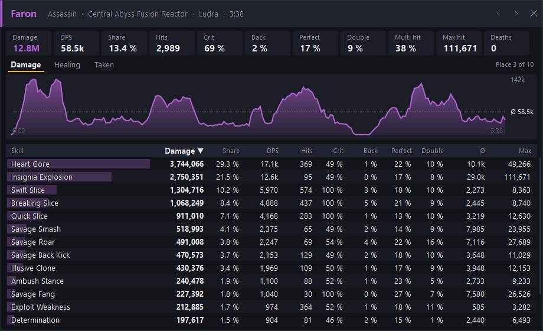

# DPS Meter for Aion 2

**Deutsch:** [LIESMICH.md](LIESMICH.md)

A damage meter overlay for Aion 2, in the style of NotMeter and A2Tools: damage, healing and damage taken per player,
and a click on a player opens their **skill details**. It only reads the network traffic of Aion 2 (Npcap, like
Wireshark) and changes nothing in the game. Its only internet connection is the update check on GitHub (can be
switched off).





*Player names in the images are made up.*

- **Meter:** a row per player in class colour with DPS, total, share and deaths. Tabs for damage, healing and damage
  taken. A click on the fight title picks the fight: the current one, all fights together, or an earlier one.
- **Fights are found by themselves.** Every boss gets its own fight, with its HP in the header. A fight ends when all
  enemies are dead or nothing hits for a few seconds.
- **Skill details:** tiles (damage, DPS, share, hits, crit, back attack, perfect, double, multi hit, max hit, deaths),
  DPS over the fight, and a sortable table of every skill with share, DPS, hits, crit %, back %, perfect %, double %,
  multi hit %, average, max and misses. Damage over time has its own row. ◀ ▶ steps through the players.
- **Summons, traps and effects** (spirits, Bittercold Wind, Divine Aura …) count for the player who cast them.
- **Checked against the game:** on recordings of dungeon runs and the Ludra raid, the damage counted on a boss matches
  the HP it lost to 100.0–100.5 % (the rest is the overkill of the last hit).
- **English or German**, follows the Windows language (menu "Language / Sprache").

> **Warning:** According to another tool author, NCSOFT support considers software that reads game data a violation of
> the terms of service. **Use at your own risk.**

## Download

1. Install [**Npcap**](https://npcap.com/#download) (default options; leave "Restrict Npcap driver's access to
   Administrators only" unticked).
2. Download `DpsMeter.exe` from [**Releases**](../../releases/latest) and start it. No installation, .NET is included.
   If SmartScreen warns: *More info → Run anyway* (the file is not signed).
3. Play Aion 2 in **borderless window** mode; exclusive fullscreen hides overlays. If the game was already running,
   change the zone or teleport once so the meter sees your character.

The meter appears at the top right, plus an icon in the notification area (right-click = menu, left-click = show/hide).

| Key | Effect |
|---|---|
| Ctrl+Alt+D | show / hide the meter |
| Ctrl+Alt+N | new fight |
| Ctrl+Alt+L | lock: clicks go through the meter to the game |

Drag the header to move, drag the edges to resize, right-click for the menu: opacity, text size, fight end after x
seconds, language, copy a summary, automatic updates.

**Updates** install themselves: the meter checks GitHub after the start and every 6 hours and installs a new version
only while you are not in a fight or a dungeon, then restarts. Settings and the error log are in `%APPDATA%\DpsMeter`.

## Who is counted

- You always, with your summons, traps and effects.
- In dungeons and raids every player of the instance.
- In the open world other players only on enemies you are fighting yourself (there is no party detection yet).

**Limits:** Healing is less exact than damage: known heal skills and heals over time count, shields and potions do not.
Hits of an effect whose cast was not seen (e.g. the meter was started mid-fight) are shown as "Others".

## Testing without the game

```
DpsMeter replay <recording.pcapng> [--speed 4]       play a recording in the meter
DpsMeter report <recording.pcapng> [--skills]        every fight as text, boss damage against boss HP
DpsMeter preview <recording.pcapng> [--anonymous]    meter and skill details as PNG images
```

Recordings of the [Raid Announcer](https://github.com/dr89mh/aion2-raid-ansager) and of
[Cube Radar](https://github.com/dr89mh/aion2-cube-radar) work as they are.

## Building

```
git clone --recurse-submodules https://github.com/dr89mh/aion2-dps-meter.git
cd aion2-dps-meter
dotnet build -c Release     # bin\Release\net10.0-windows\DpsMeter.exe
publish.cmd                 # dist\DpsMeter.exe (single file, .NET included)
```

Requires the .NET 10 SDK. Capture, TCP reassembly and framing come from the core of
[Cube Radar](https://github.com/dr89mh/aion2-cube-radar) (submodule `external/aion2-cube-radar`).

| Path | Content |
|---|---|
| `Protocol/CombatDecoder.cs` | frames → events: hit `04 38` (amount, crit, back/front, perfect, double, multi, block/parry), damage/heal over time `05 38`, cast `02 38`, spawn with owner `41 36`, death `04 8D`, HP `00 8D`, zone `01 40` |
| `Meter/Entities.cs` | players, summons and effects and who they belong to |
| `Meter/MeterEngine.cs` | fight detection, counting rules, views for the windows |
| `App/MeterForm.cs`, `App/DetailForm.cs` | the meter overlay and the skill details |
| `App/Updater.cs` | automatic updates from the GitHub releases |
| `data/` | English and German skill, NPC and dungeon names, built with `tools/make_data.py` |

## License

GPL-3.0. Skill, NPC and dungeon data come from
[cyberbadger6969/aion2-dps-meter](https://github.com/cyberbadger6969/aion2-dps-meter) (GPL-3.0), which takes them from
[A2Tools-DPS-Meter](https://github.com/taengu/A2Tools-DPS-Meter) (GPL-3.0). Packet layouts come from aion2-dps-meter and
HamMeter-Aion2. Game content and names belong to NCSOFT.
